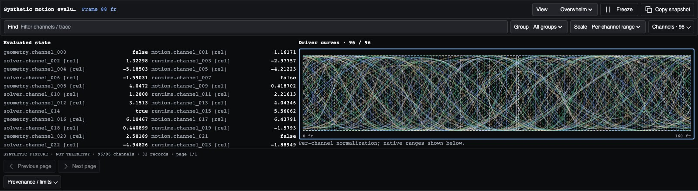

# Debug console

An optional, read-only Shared UI component for real diagnostic data. The same component hosts dense evaluated-state tables, sampled curves and machine-style trace records in any native-DOM application. It does not know about Aura, robot scenes, renderers, application History or transport.



The screenshot and `public/debug.html` use explicitly labelled synthetic catalogue data. No private application or client material is included.

## Install and embed

Build with `npm run check`. Install the ordinary reviewed bundle as usual, then install the optional component into the same local asset directory:

```sh
node scripts/install.mjs --target /your/app/shared-ui
node scripts/install-debug.mjs --target /your/app/shared-ui
node scripts/install-debug.mjs --target /your/app/shared-ui --check
```

Serve the reviewed local assets; the debug JavaScript is not fetched or executed by the automatic CSS update channel.

```html
<html data-ui="postvisual" data-theme="dark" data-ui-version="1.12.0">
  <head>
    <link rel="stylesheet" href="/shared-ui/styles.css" data-ui-baseline>
    <link rel="stylesheet" href="/shared-ui/debug.css">
    <script defer src="/shared-ui/runtime.js"></script>
    <script defer src="/shared-ui/debug.js"></script>
    <script defer src="/app-debug.js"></script>
  </head>
  <body><div id="debug-host"></div></body>
</html>
```

```js
// app-debug.js — the host supplies actual observations; no polling is required
// by the component. A host can instead use update(packet) directly.
const panel = SharedUI.createDebugPanel({
  title: 'Evaluator',
  sprite: '/shared-ui/icons.svg',
  adapter: {
    snapshot: () => diagnostics.currentPacket(),
    subscribe: receive => diagnostics.onPacket(receive), // return unsubscribe
  },
  onError: error => console.error(error),
});
document.querySelector('#debug-host').append(panel.element);
panel.refresh();
// On teardown: panel.destroy();
```

`diagnostics` above is the consuming application's own observation source, not a Shared UI service. Application state must be sanitized before supplying packets. `src/debug.d.ts` / the installed `debug.d.ts` describe the packet and interface; runtime entry points are on `window.SharedUI`, not named ESM exports.

## Data contract

```js
{
  version: 1,
  epoch: 'execution-id:source-revision',
  title: 'Contact evaluation',
  cursor: 60,
  axis: {label: 'Frame', unit: 'fr'},
  status: 'CONTACT / HOLD',
  channels: [{
    id: 'tool.lift', label: 'tool.lift', group: 'Motion',
    kind: 'number', unit: 'm', basis: 'Evaluated authored motion',
    value: 0,
    // Coordinates and values supplied by the host, in native units:
    samples: [{x: 0, value: 0.2}, {x: 12, value: 0}, {x: 13, value: null}],
  }],
  traces: [{
    id: 'cue-17', x: 60, op: 'CUE', level: 'info',
    fields: {contact: true}, text: 'Authored cue, not sensor acknowledgement',
  }],
  provenance: ['Authored animation; not recorded robot telemetry'],
  notices: ['Inspection samples are sparse, not a frame-complete recording'],
}
```

Channels can be numerical, boolean or text. Booleans use step paths; text is a state value, not an invented numerical signal. Nonfinite values become null; null sample values break a graph rather than suggesting continuity. Duplicate sample coordinates use the last supplied value. Optional `domain: [min,max]` specifies the native numerical range.

Change `epoch` when switching source/execution; it resets channel selection and inspection position. The host decides whether backward seeking invalidates its observed history. The component does not combine timelines or extrapolate values. A late initial adapter snapshot cannot overwrite a newer subscription update; old adapter callbacks are ignored after reconnect/destroy.

## Views

The view selector exposes **Overview**, **All curves**, **Channel lanes**, **State matrix**, **Machine listing**, **Raw packet**, and **Overwhelm**. Overview retains the bottom-console pairing of evaluated values and driver curves. Overwhelm combines a dense matrix, all matching numeric/boolean curves and recent diagnostic records; every item still comes from the host packet.

The machine listing renders line numbers, actual coordinates, supplied operation labels and fields. It resembles a machine program without claiming to be executable G-code. No `G01`, robot acknowledgement, measurement or event is fabricated. Source provenance remains available in the footer disclosure.

Filter by group/text, then select or isolate channels through the native channel checklist. All curves plots every matching sampled numeric/boolean channel up to the published bound. Lane pages show 24 channels; the matrix shows 96 and the listing 128 records per page. Curves have per-channel normalization with native ranges in the legend, or a shared raw scale. Do not compare raw channels with incompatible units. Pointer or Left/Right/Home/End keyboard inspection reports the nearest supplied sample; it never seeks application transport. Escape returns to the current cursor.

Freeze retains the current debug snapshot while the application continues. Resume shows the latest pending packet, not a backlog. Copy snapshot exports the normalized packet. The raw view limits displayed text to 512 KiB, explicitly indicating truncation; copying includes the bounded normalized packet.

## Styling and host placement

Both Postvisual and Personal use the same DOM/behavior and semantic shared controls. Debug-only role tokens are local to `.ui-debug`:

`--ui-debug-bg`, `--ui-debug-text`, `--ui-debug-muted`, `--ui-debug-line`, `--ui-debug-channel-1` through `-4`, `--ui-debug-size`, and `--ui-debug-plot-height`.

They alias the existing palette rather than inventing a new page theme. Graph colors resolve through computed shared CSS, including light/dark modes. Apps own only placement and available panel height, for example `.app-debug > .ui-debug { block-size: 320px; }` in `@layer app`. Do not restyle native buttons/fields in an app-specific debug stylesheet. For a manual theme change call `panel.refresh()`; normal observed packet updates also repaint with current tokens.

## Extending and lifecycle

`update`, `connect`, `setView`, `setFrozen`, `setVisible`, `refresh`, `getState` and `destroy` are instance methods. `registerView({id,label,mount})` adds a host-owned view; mount receives a container and `{document,format}` and returns optional `update(packet,{channels,format})` / `destroy()` methods. The returned unregister function removes the view. This is a trusted local rendering extension, not executable content accepted in packets.

The component uses dirty-frame scheduling with no free-running animation. Hidden/disconnected/intersection-hidden documents do not paint; `setVisible(false)` suspends drawing. The adapter may continue publishing; consuming apps should unsubscribe expensive sources when hidden. Destroy cancels scheduled work and releases adapters, resize/intersection observers, listeners and custom views. Multiple instances have independent filters, freeze, cursor and view state. No global app store or local storage is created.

## Bounds, truthfulness and packaging

Maximum accepted packet: 512 unique channels, 2,048 retained supplied points per channel, 2,048 recent trace records, 512 characters per scalar text value. Truncation is reported. The plot uses min/max-preserving reduction so narrow spikes survive; gaps remain discontinuities. This is a bounded inspection surface, not an unbounded telemetry recorder. Hosts must not provide credentials, private raw logs or unsupported claims as data. Shared UI renders supplied strings as text, not HTML.

The base CSS remains 36,310 bytes raw / 8,184 gzip. The optional component has independent hard build limits: CSS 6 KiB raw / 2 KiB gzip, JS 32 KiB raw / 10 KiB gzip. `debug.manifest.json` records measured sizes, hashes and required base version. Both build and installer validate before replacing working assets; this bundle stays outside the CSS-only channel.

## Verification

`npm test` includes packet normalization, missing data, range semantics, spike/gap preservation, real-record machine formatting and atomic integrity installation. `node test/debug.browser.mjs` is an optional Playwright acceptance script (Playwright belongs to the testing environment, not the package/runtime dependency list). It checks both packs and themes at three widths, seven views, independent freeze and filtering, keyboard sample inspection, async ordering, extension disposal and multiple hosts. The public fixtures are deliberately synthetic.
